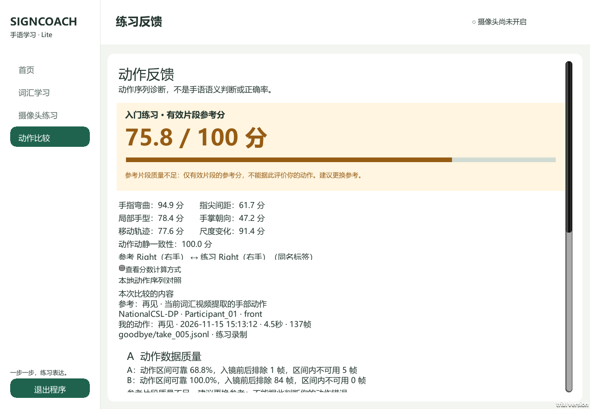

# SignCoach Lite

Unity + Python/MediaPipe 的中文手语动作学习与几何对照程序。
本仓库保存开发源码。Windows免安装运行包：[下载页面](https://github.com/HQQ119/MediaPipe/releases/tag/v0.5.2)。下载 `SignCoachLite-Windows-v2.1.zip`，完整解压后运行 `Windows/SignCoachLite.exe`，无需安装Unity或Python。

**不要只下载exe，也不要将源码的Download ZIP当成Windows运行包。** 运行包包含Vision、UnityPlayer.dll及SignCoachLite_Data等完整依赖。

## 项目内容

- SignCoachUnity/Assets：Unity场景、C#脚本、六词本地视频、关键点和素材来源说明，保留全部.meta。
- SignCoachUnity/Packages、ProjectSettings：Unity项目依赖和配置。
- SignCoachUnity/data/reference：原有算法回归所用的录制样本，不表示标准手语。
- SignCoachLite：Python识别、TCP、提取工具、测试与依赖清单。

当前词汇：再见、谢谢、对不起、吃饭、帮助、喜欢。默认入门练习评分，保留精细对照；动作几何相似度不代表手语语义正确率。质量不足的参考仍会提示。

## 开发运行

Unity Hub打开SignCoachUnity，使用项目ProjectVersion.txt指定的Unity版本（本机为2022.3.62f3c1）。打开Assets/Scenes/SignCoachDebug.unity。
Python使用3.12 64位，在SignCoachLite目录运行：

```powershell
py -3.12 -m venv .venv
.\.venv\Scripts\python.exe -m pip install -r requirements.txt
.\.venv\Scripts\python.exe main.py --download-model
.\.venv\Scripts\python.exe main.py --tcp --no-display
```

模型首次运行由程序从官方源下载，源码不包含虚拟环境或模型。其他参数及Windows说明见SignCoachLite/README.md。更早文档中“本机已准备环境”的描述只指原开发机，克隆后仍需安装。

Python测试：在SignCoachLite运行`.\.venv\Scripts\python.exe -m unittest discover -v`。Unity自动验证与Release构建入口为Assets/Editor/BuildAndVerify.cs的BuildAndVerify.Execute。ScoringProfileTests对外部原交付目录的三份真人录制进行可选联调；该目录未包含在仓库，外部联调会明确SKIP，受控算法测试照常执行。

独立视觉服务打包：先安装requirements-build.txt并下载模型，再运行SignCoachLite/build_vision.ps1，生成SignCoachUnity/Build/Vision/SignCoachVision/。现有Unity启动器兼容此布局。打包方法见各项目README。

## 仓库与运行包

仓库保存源码，Releases保存完整Windows运行包，不跟踪虚拟环境、Unity缓存和Build产物。根目录data/reference保留原仓库已上传的历史练习；SignCoachUnity/data/reference保留算法回归样本。原始研究下载缓存未包含；运行和构建所需的本地片段与来源清单已保留在StreamingAssets/Teaching。
Windows运行包的exe、SignCoachLite_Data、UnityPlayer.dll、MonoBleedingEdge和Vision必须保持完整，不能为了减小体积随意删除。
保留素材来源和第三方授权说明，不代表取得额外授权。

## 实际验证记录

评分档位实测、文件保护和六词入口检查见[验证材料](docs/verification/)。这些是此前实际Windows Release的测试结果，本次仅整理和发布文件，没有新一轮真人采集。


